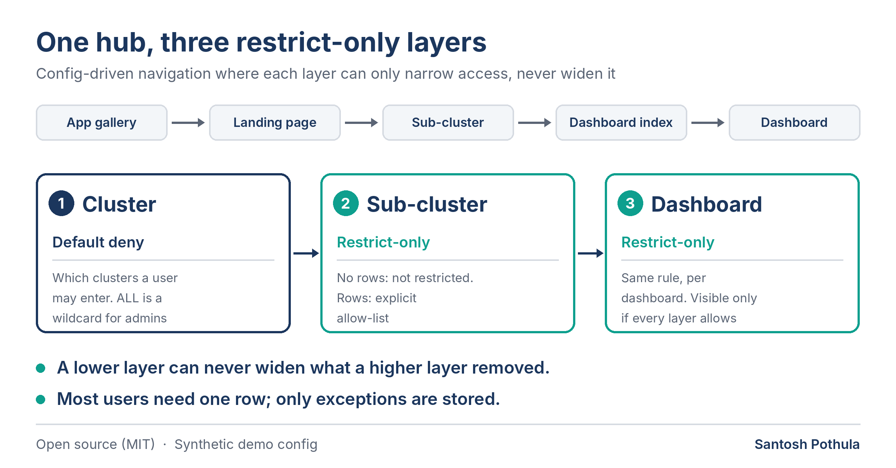

# Navigation Hub Access Pattern

A config-driven navigation hub for Power BI, and the **three-layer restrict-only access model** behind it, with a small tested reference implementation.

> **Clean-room demo.** Everything here is synthetic: invented apps, clusters, users and `example.com` addresses. No employer or client data, names, tenants or schemas are included. The pattern is a general design; the code is an independent reference implementation.



## The problem

One organisation, many Power BI apps and dozens of dashboards. People need a single branded entry point that shows each of them only what they are entitled to, and admins need to manage that without editing pages or maintaining one permission row per person per dashboard.

## The idea

- **Five tiers, driven by config tables:** app gallery, landing page, sub-cluster, dashboard index, dashboard. Adding a dashboard is adding a row.
- **Three access layers** (cluster, sub-cluster, dashboard). Layer 1 is default deny. Layers 2 and 3 are **restrict-only**: no rows means no restriction, rows mean an explicit allow-list.
- **A dashboard is visible only if it survives every active layer.** A lower layer can never widen what a higher layer removed.
- Only exceptions are stored, so most users need a single row.

Details: [docs/access-model.md](docs/access-model.md) and [docs/architecture.md](docs/architecture.md).

## Try it

Python 3.9+, standard library only.

```bash
python run.py resolve bob@example.com        # what can Bob see?
python run.py resolve carol@example.com
python run.py resolve alice@example.com      # super admin: everything
python run.py check                           # lint the config tables
python -m unittest discover -s tests          # 13 tests
```

Output for `bob@example.com`:

```
Demo Maritime > OPS_HUB > Berth > Berth Utilisation
Demo Maritime > OPS_HUB > Berth > Vessel Waiting Time
```

Point `--config` at your own folder of CSVs with the same columns to test a real design before building it in a semantic model.

## What is in the repo

| Path | What |
|---|---|
| `src/navhub/access.py` | Reference implementation of the funnel and the config lint |
| `sample_config/` | Synthetic config tables (`ClusterConfig`, `DashboardIndex`, three access tables) |
| `tests/` | Unit tests, including "a lower layer never widens a higher one" |
| `dax/rls_sketch.dax` | **Illustrative** DAX version of the same rule for an RLS role |
| `docs/` | Access model, architecture and practical lessons |

## What the lint catches

Typos and renamed dashboards in allow-lists, restriction rows for clusters a user was never granted, and dashboard rows that a higher layer already hides. A single restriction row flips a user from "everything" to "only what is listed", so these mistakes are easy to make and silent.

## Limitations

- **The DAX file is a sketch.** It has not been tested in Power BI from this repo. The unit-tested Python is the specification; test the DAX with *View as roles* in Desktop before relying on it.
- **Demo simplification:** layer 1 is default deny here. A real deployment may choose a different default.
- **Per-user rows do not scale forever.** Keying the same funnel on security groups is the usual next step (see the access-model notes).
- This repo does not include the HTML card rendering, icon assets, page design files or the PowerShell audit pipeline. They are described in the architecture notes, not published.

## License

MIT, see `LICENSE`. Author: Santosh Pothula
